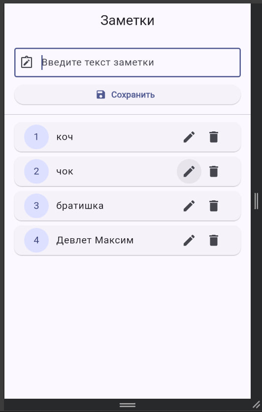

# Практическая работа №2: Разработка Flutter-приложения «Заметки»

Учебный проект по дисциплине «Разработка мобильных приложений» (темы: `TextEditingController` и `ListView`).

## 1. О проекте
Приложение «Заметки» выполнено в строгом соответствии с материалами учебной лекции:
- Весь исполняемый Dart-код расположен в единственном файле [lib/main.dart](file:///c:/Users/User/Desktop/MOB_DART/pr2Mob/lib/main.dart).
- Архитектура не перегружена сторонними библиотеками: управление состоянием выполнено через стандартный `StatefulWidget` и `setState()`.
- Данные хранятся в оперативной памяти (`List<String> _notes`).

## 2. Реализованный функционал (Оценка 5)
1. **Текстовое поле ввода (`TextField`)**:
   - Привязка к `TextEditingController`.
   - Добавлен слушатель изменений текста `addListener` в `initState()` и обязательное снятие слушателя `removeListener` с `dispose()` в методе жизненного цикла `dispose()`.
   - Подсказка: `"Введите текст заметки"`.
2. **Добавление заметок**:
   - По нажатию на кнопку «Сохранить» введенный текст валидируется и добавляется в список заметок, а поле ввода очищается через `_controller.clear()`.
3. **Отображение списка заметок (`ListView.builder`)**:
   - `ListView.builder` обернут в `Expanded` для предотвращения переполнения экрана.
   - Явно заданы параметры из лекции: `scrollDirection: Axis.vertical` и `padding: const EdgeInsets.all(8.0)`.
   - Каждая заметка оформлена с помощью виджетов `Card` и `ListTile`.
4. **Удаление заметок**:
   - Кнопка с иконкой `Icons.delete` в правой части карточки (`trailing`).
   - Удаление элемента по индексу через `_notes.removeAt(index)`.
   - Если удаляется заметка, находящаяся в режиме редактирования, режим сбрасывается и поле очищается.
5. **Редактирование заметок**:
   - Кнопка с иконкой `Icons.edit` в карточке заметки.
   - Текст выбранной заметки загружается в поле ввода: `_controller.text = _notes[index];`.
   - Текст кнопки меняется на «Обновить».
   - Добавлена кнопка «Отмена» для удобного выхода из режима редактирования.
   - При нажатии «Обновить» элемент списка перезаписывается, поле очищается, и приложение возвращается в стандартный режим.

## 3. Пример работы приложения

<p align="center">
  
</p>

## 4. Запуск проекта
Для запуска в браузере (Google Chrome):
```bash
flutter run -d chrome
```

Для запуска в среде Windows Desktop:
```bash
flutter run -d windows
```
