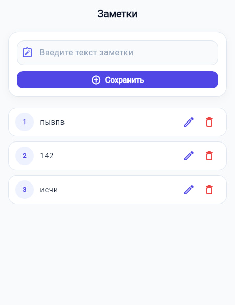

# Практическая работа №2
## Разработка приложения «Заметки» на Flutter

Тема: Изучение виджетов пользовательского ввода (`TextEditingController`) и динамических списков (`ListView`).

### Цель работы
Создание приложения для управления списком заметок в оперативной памяти с поддержкой полного жизненного цикла контроллеров ввода и базовых операций: добавление, просмотр, редактирование и удаление записей.

### Структура проекта
- `lib/main.dart` — точка входа, конфигурация темы Material 3, логика контроллера и интерфейс приложения.
- `pubspec.yaml` — конфигурационный файл зависимостей проекта.
- `test/widget_test.dart` — проверка корректности отрисовки базовых компонентов интерфейса.

### Реализованные модули

1. Управление вводом данных:
   - Использование `TextEditingController` для считывания и установки текста в поле `TextField`.
   - Регистрация слушателя изменений текста через `addListener` в методе `initState()`.
   - Корректное освобождение ресурсов контроллера через `removeListener` и `dispose()` при уничтожении виджета.
   - Подсказка для пользователя в поле ввода и валидация на непустую строку.

2. Отображение списка:
   - Построение динамического списка с помощью `ListView.builder`.
   - Размещение списка внутри виджета `Expanded` для предотвращения переполнения экрана.
   - Оформление записей с использованием `Card` и `ListTile` с отображением порядкового номера элемента.
   - Информационная заглушка при отсутствии записей в списке.

3. Операции над заметками:
   - Добавление новой заметки и автоматическая очистка текстового поля.
   - Редактирование выбранной записи: заполнение поля ввода текущим текстом заметки, переход кнопки в режим «Обновить» и возможность отмены операции.
   - Удаление записи из списка по индексу с автоматической корректировкой указателя текущего редактирования.

### Внешний вид приложения



### Порядок запуска

1. Загрузка зависимостей:
```bash
flutter pub get
```

2. Запуск в веб-браузере:
```bash
flutter run -d edge
```
или
```bash
flutter run -d chrome
```

3. Запуск в виде Windows-приложения:
```bash
flutter run -d windows
```
